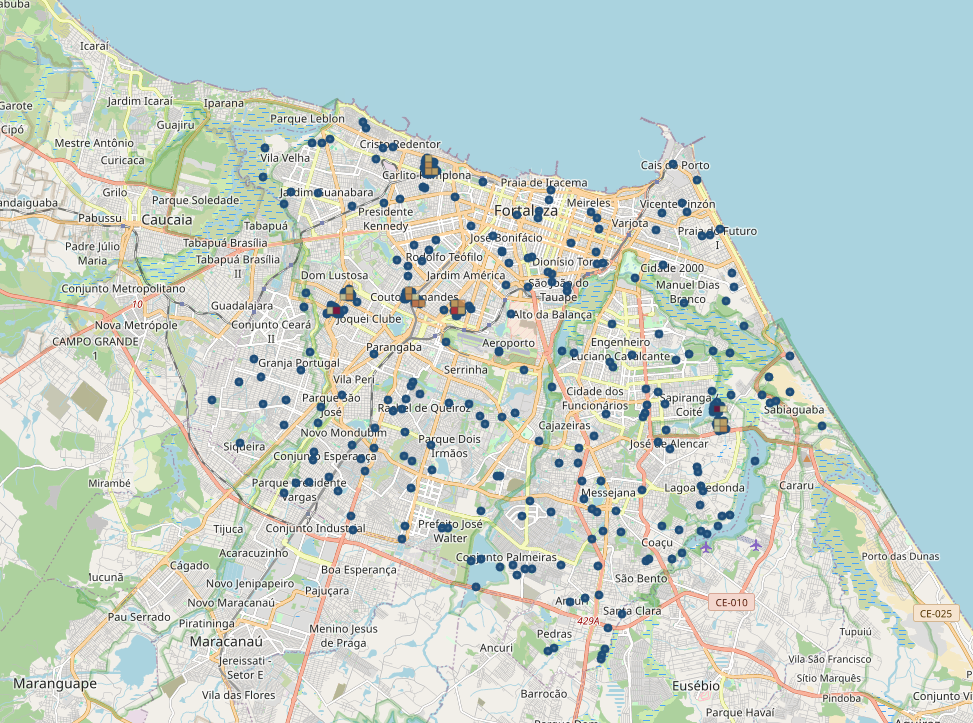

# Denúncias × vistorias com PostGIS e QGIS

Projeto de análise espacial que guarda dados territoriais no PostgreSQL/PostGIS, cruza registros de denúncias e vistorias para achar áreas com recorrência de descarte irregular e apresenta o resultado em mapas (QGIS e mapa web).

> As denúncias e vistorias são **fictícias**, geradas por `scripts/gen_fake_data.py`. Os bairros "críticos" são sorteados e não correspondem a nenhum bairro real. Os polígonos dos bairros podem ser reais (malha de Fortaleza) ou uma grade fictícia.

**Requisitos:** Docker (com Docker Compose), Python 3.13+ e, para a visualização, o QGIS.

## Estrutura

```
├── docker-compose.yml         # PostgreSQL 16 + PostGIS 3.5
├── pyproject.toml / uv.lock   # dependências (uv)
├── requirements.txt           # dependências (pip)
├── data/                      # arquivo de bairros (ignorado pelo git)
├── img/                       # imagem do mapa web (image.png) e layout do QGIS (mapa.pdf)
├── scripts/
│   ├── common.py              # conexão com o banco e CRS de trabalho (EPSG:31984)
│   ├── load_bairros.py        # carrega os bairros e reprojeta para 31984
│   ├── gen_fake_data.py       # gera denúncias e vistorias fictícias
│   └── make_map.py            # gera mapa.html (Folium)
└── sql/
    ├── 01_schema.sql          # extensão, tabelas e índices espaciais
    ├── 02_consultas.sql       # análises (junção espacial, raio, grade)
    ├── 03_views.sql           # views para abrir no QGIS
    └── 04_experimento_crs.sql # comparação metros × graus
```

## Modelo de dados

Todas as geometrias ficam em **EPSG:31984** (SIRGAS 2000 / UTM zona 24S), um CRS projetado em metros. Assim, distância, área e raio das consultas são em metros e m².

| Tabela | Geometria | Colunas |
|---|---|---|
| `bairros` | `MultiPolygon` | `id`, `nome`, `regional` |
| `denuncias` | `Point` | `id`, `data_denuncia`, `tipo` |
| `vistorias` | `Point` | `id`, `data_vistoria`, `autuado` |

- Cada coluna `geom` declara o SRID, e o banco recusa geometria com SRID diferente.
- Há índices espaciais `GIST` nas três tabelas e índices de data em `denuncias` e `vistorias`.
- **Não existe chave ligando vistoria a denúncia.** O vínculo é feito por proximidade (100 m) e janela de datas (até 30 dias depois da denúncia).

## Como executar

### 1. Subir o PostGIS

```bash
docker compose up -d
docker compose logs -f db        # espere "ready to accept connections" e saia com Ctrl+C
docker compose exec db psql -U geing -d geing -c "SELECT PostGIS_Full_Version();"
```

- Imagem `postgis/postgis:16-3.5`.
- A porta no computador é a **5434**, mapeada para a 5432 do contêiner.
- Usuário, senha e banco: `geing`. As variáveis `POSTGRES_*` só valem na primeira inicialização, com a pasta de dados vazia. Para recomeçar do zero: `docker compose down -v`.
- A pasta `sql/` é montada no contêiner em `/sql`, então `psql -f /sql/...` funciona em qualquer sistema.

### 2. Ambiente Python

Com uv:

```bash
uv sync
```

Ou com pip:

```bash
python -m venv .venv
source .venv/bin/activate          # Windows PowerShell: .venv\Scripts\Activate.ps1
pip install -r requirements.txt
```

Os scripts usam por padrão `localhost:5434` e usuário/senha/banco `geing`. Para mudar, defina `PGHOST`, `PGPORT`, `PGUSER`, `PGPASSWORD` e `PGDATABASE`.

### 3. Criar as tabelas

```bash
docker compose exec db psql -U geing -d geing -f /sql/01_schema.sql
```

O script recria as três tabelas e imprime a versão do PostGIS e a tabela `geometry_columns`, com o SRID de cada coluna.

### 4. Carregar os bairros

**Com a malha real de Fortaleza** (121 bairros), salva em `data/Bairros_de_Fortaleza.geojson`:

```bash
python scripts/load_bairros.py \
  --file data/Bairros_de_Fortaleza.geojson \
  --name-col Nome \
  --regional-col "Regional Atual"
```

O arquivo está em EPSG:4326. O script lê o CRS do arquivo, remove espaços e quebras de linha dos nomes, converte as geometrias para `MultiPolygon` 2D válido e reprojeta para 31984 antes de gravar. Ao final, imprime o número de bairros e a área total em km². Se o arquivo não informar o CRS, use `--source-crs EPSG:4326` (ou o CRS correto).

Fontes possíveis para a malha de bairros:

- Fortaleza em Mapas: <https://mapas.fortaleza.ce.gov.br/>
- Portal de Dados Abertos de Fortaleza: <https://dados.fortaleza.ce.gov.br/>
- IBGE, Malha de Bairros do Censo 2022

Para inspecionar um arquivo antes de carregar:

```bash
python -c "import geopandas as gpd; g=gpd.read_file('data/Bairros_de_Fortaleza.geojson'); print(g.crs, len(g)); print(g.columns.tolist())"
```

**Com uma grade fictícia**, sem baixar nada:

```bash
python scripts/load_bairros.py --demo-grid
```

Cria 64 "bairros" (grade 8 × 8) sobre uma caixa aproximada de Fortaleza.

### 5. Gerar denúncias e vistorias

```bash
python scripts/gen_fake_data.py --n-denuncias 3000 --seed 42
```

O script simula:

- 3.000 denúncias nos últimos 365 dias, de cinco tipos: `descarte_irregular` (55%), `poluicao_sonora` (15%), `poluicao_visual` (12%), `comercio_irregular` (10%) e `vigilancia_sanitaria` (8%);
- "pontos crônicos" de descarte irregular: 2 aglomerados em cada um de 5 bairros sorteados, com 60% dos descartes concentrados neles;
- vistorias que respondem a parte das denúncias, de 1 a 30 dias depois e a cerca de 25 m do ponto original, com menor taxa de atendimento nos pontos crônicos;
- 300 vistorias de "busca ativa", sem denúncia por trás.

Parâmetros: `--n-denuncias`, `--n-busca-ativa`, `--n-hotspot-bairros` e `--seed`. A mesma `--seed` gera exatamente os mesmos dados, e as tabelas `denuncias` e `vistorias` são esvaziadas a cada execução.

### 6. Rodar as análises

```bash
docker compose exec db psql -U geing -d geing -f /sql/02_consultas.sql
```

As consultas também podem ser executadas uma a uma no DBeaver, no pgAdmin ou no DB Manager do QGIS.

| # | Análise | Técnica |
|---|---|---|
| 0 | Linhas e SRID de cada tabela | Conferência do CRS |
| 1 | Denúncias por bairro | Junção espacial com `ST_Intersects` |
| 2 | Denúncias por km² | `ST_Area` (m², pois o CRS é projetado) |
| 3 | Denúncias sem vistoria em 100 m e 30 dias | `ST_DWithin` + janela de datas, com `NOT EXISTS` |
| 4 | Taxa de atendimento por bairro (bairros com 20+ denúncias) | CTE com `EXISTS` e `COUNT(*) FILTER` |
| 5 | Tempo até a primeira vistoria próxima, por tipo | `LEFT JOIN LATERAL` com `LIMIT 1` |
| 6 | Descarte irregular em grade de 250 m, últimos 90 dias | Grade com `FLOOR(x / 250)` |

### 7. Criar as views e abrir no QGIS

```bash
docker compose exec db psql -U geing -d geing -f /sql/03_views.sql
```

| View | Conteúdo |
|---|---|
| `vw_hotspots_250m` | Células de 250 m com 3 ou mais denúncias de descarte irregular nos últimos 90 dias. Colunas: `id`, `i`, `j`, `denuncias_90d`, `sem_vistoria` e `geom` |
| `vw_denuncias_pendentes` | Denúncias sem vistoria a até 100 m nos 30 dias seguintes |

No QGIS:

1. Camada → Adicionar Camada → Adicionar Camada PostGIS → **Novo**: host `localhost`, porta `5434`, banco `geing`, usuário `geing`, senha `geing`.
2. Adicione `bairros`, `denuncias`, `vw_hotspots_250m` e `vw_denuncias_pendentes`. Para as views, escolha `id` como chave primária.
3. Em Projeto → Propriedades → SRC, defina **EPSG:31984**.
4. Simbologia sugerida: `vw_hotspots_250m` como **Graduado** por `denuncias_90d`; `denuncias` como **Mapa de calor**; `bairros` só com contorno.
5. O **DB Manager** permite rodar uma consulta de `02_consultas.sql` e adicionar o resultado ao mapa como camada.
6. Um layout de impressão exportado em PDF fica em [img/mapa.pdf](img/mapa.pdf).

### 8. Experimento de CRS

```bash
docker compose exec db psql -U geing -d geing -f /sql/04_experimento_crs.sql
```

Compara a distância entre duas denúncias em quatro situações:

| | Cálculo | Unidade do resultado |
|---|---|---|
| A | CRS projetado (31984) | metros |
| B | Após `ST_Transform` para 4326 | graus |
| C | 4326 com o tipo `geography` | metros, sobre o elipsoide (próximo de A) |
| D | Pares de denúncias "a 100 m" entre as 200 primeiras | em 4326, `100` vira 100 graus e todos os 19.900 pares passam no teste |

Em lat/long, medir em metros exige o tipo `geography` ou reprojetar antes.

### 9. Mapa web (opcional)

```bash
python scripts/make_map.py
```

Gera `mapa.html` com:

- contorno dos bairros;
- células de 250 m coloridas por número de denúncias em 90 dias, com o número de denúncias sem vistoria no tooltip;
- as 500 denúncias pendentes de descarte irregular mais recentes (camada desligada por padrão).



*Mapa web (`mapa.html`) com a camada de denúncias pendentes ligada.*

O mapa de fundo precisa de internet. O banco trabalha em 31984, e o script reprojeta para 4326 só na saída, porque mapas web esperam lat/long. O arquivo `mapa.html` é ignorado pelo git.
